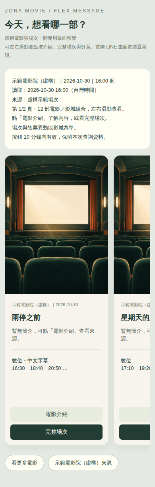

# 電影夥伴 Bot 06：Google ADK × LINE Flex Message

問「誠品現在有哪些電影好看？」時，先由 Google ADK 查該影城的實際場次，再以可以左右滑動的電影卡片呈現。

- 每頁十部電影，卡片含海報或預設封面、片名、簡介、放映版本與前三個時間。
- 點「電影介紹」看簡介與來源；點「完整場次」查看同一作品所有版本的來源時間。
- 每批最後加上「下一批電影 →」導航卡；最後一批提供「← 上一批電影」。每頁仍最多十部電影，導航卡另外一張。
- 保留「看更多電影」「上一頁」快速按鈕，沿用同一次查詢的影城、日期與時間條件。
- 多版本在同一電影卡片分列；跨館比較仍保留各自影城與日期。
- 同名作品有疑義、查不到海報或 TMDB 暫時失敗時，保留真正的影城片單與時間，使用預設封面。
- 沒有公告、沒有符合時間的場次或僅圖片來源時，清楚回覆現況及來源。



[滑到底的導航卡預覽](docs/images/flex-navigation-mobile.png) · [最後一批返回入口](docs/images/flex-last-page-mobile.png)

## Google ADK 在哪裡？

沿用 `@google/adk` 的 `LlmAgent`、`FunctionTool` 與 `InMemoryRunner`。自然語言問題仍由 agent 判斷並呼叫 `cinema_schedule`／`cinema_compare`；程式直接將工具結果組成 Flex JSON，模型不能替換電影或時間。

卡片的翻頁和明確的查看操作，經 LINE 驗簽後由程式處理，避免重跑模型與整份查詢。按鈕只帶隨機索引 token，後端綁定已驗證的使用者，不接受前端指定他人的身分或電影來源網址。對話中仍可繼續用自然語言修改日期、影城或查其他資訊。

本版先完成影城片單／場次的卡片呈現。「幫我挑電影」沿用 Bot 05 的 TMDB 類型推薦；尚未改為 Flex，也未新增依私人收藏的推薦。

## 既有功能

保留 Bot 05 四格 Rich Menu（電影查詢／我的票匣／附近影院／幫我挑電影）、Published MINI App、登入相容流程與票根草稿確認。沿用同一份私人 SQLite，推薦與卡片不會寫入票根。

- [Zona Movie LINE](https://line.me/R/ti/p/@796qcwyz)
- [正式票匣](https://miniapp.line.me/2012222034-AVyO2nk3)
- [卡片架構與限制](docs/flex-message.md)
- [前一版 Rich Menu 文章](https://github.com/zonawang/movie-companion-bot-05-richmenu/blob/main/medium.md)

## 開發與驗證

Node.js 24.13+、npm 11.8+：

```sh
npm ci --ignore-scripts
npm test
npm run preview:flex
# 開啟 browser-results/flex-preview.html，內容全為虛構示範
npx playwright install chromium
npm run test:flex:browser
npm run test:browser
```

`preview:flex` 以實際 Flex JSON 產生開發用 HTML，方便檢查字數、分頁與按鈕；它不是 LINE 官方渲染器。正式 JSON 另透過 LINE `validate/reply` 驗證，實際裝置顯示仍需手機確認。

設定原有 `.env` 後，使用真實 Gemini、影城來源與 TMDB 驗證：

```sh
npm run smoke:flex:adk
```

使用記憶體資料庫與測試 actor；只呼叫 LINE 訊息格式驗證，不傳送訊息。電影實際已無公告或晚於所有場次時，真實查詢可回覆無資料；另用明確標記的 fixture 驗證卡片 JSON。

啟動：`npm start`。票匣示範：`npm run preview`。原有設定見 [部署](docs/deployment.md)、[LIFF](docs/liff-setup.md)、[Rich Menu](docs/richmenu.md)、[資料來源](docs/credits.md)。
