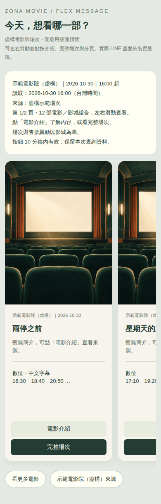
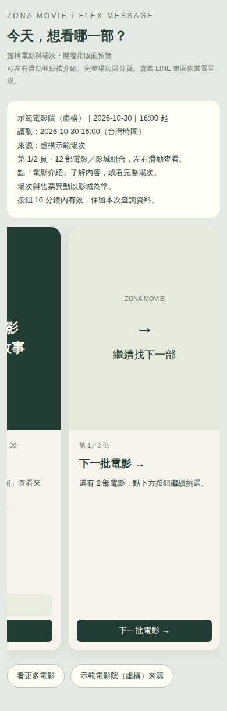

# 從一長串場次，到一張張電影卡片：用 Google ADK 與 LINE Flex Message，讓電影夥伴更好讀

[上一篇](https://github.com/zonawang/movie-companion-bot-05-richmenu/blob/main/medium.md)，我替電影夥伴做了四格 Rich Menu，讓電影查詢、私人票匣、附近影院與「幫我挑電影」有了看得見的入口，也接上 Google ADK 的偏好推薦流程。

入口比較好找之後，我開始注意到另一個使用上的問題。

當我問：

> 誠品現在有哪些電影好看？

bot 已經可以查影城片單與場次，但回覆會列出很多片名、版本和時間。資訊一多，在手機上就需要一直往下讀，也不容易比較哪一部比較有興趣。

所以，這次想整理的是查詢結果的呈現方式。

這篇記錄 Bot 06 完成的部分：**沿用 Google ADK 查影城資料，把片單改成 LINE Flex Message 電影卡片，加入每批十部的分頁、卡片列末尾的換批入口，再替缺少海報的作品準備一張電影主題插畫。**

## 先把「想挑電影」時需要的資訊放在一起

原本的文字回覆，會把來源裡的片名、版本和時間依序列出。

這樣可以核對資料，但如果我還沒決定要看哪一部，就會希望先看到幾個比較容易辨識的重點：電影長什麼樣子、大概在說什麼，以及有沒有適合的時間。

因此，這次改成每部電影一張卡片，左右滑動就能繼續看下一部。

LINE 的 Flex Message 可以透過 JSON 定義版面；其中 bubble 表示一張訊息卡片，carousel 則把多張卡片排在一起，讓使用者橫向瀏覽。[官方元件說明](https://developers.line.biz/en/docs/messaging-api/flex-message-elements/)

我先把卡片內容收斂成：

| 卡片內容 | 想幫使用者完成的事 |
| --- | --- |
| 海報或替代封面 | 快速辨識作品，也讓卡片有一致的視覺 |
| 電影名稱 | 清楚知道目前看的是哪一部 |
| 簡短介紹 | 先了解內容，再決定是否想看更多 |
| 影城與日期 | 知道這份場次屬於哪個地方、哪一天 |
| 放映版本與部分時間 | 初步判斷有沒有適合的場次 |
| 電影介紹、完整場次按鈕 | 有興趣時，再往下查看 |

卡片先展示最多兩個版本，每個版本列前三個時間。其他資訊留到點進去之後再看，避免一張卡片又變成另一份長清單。

以下畫面使用虛構電影與場次，是開發時的版面預覽；實際 LINE 顯示仍會依裝置而有差異。



## Google ADK 繼續查資料，卡片接在工具結果後面

這次沿用原本的 `LlmAgent`、`FunctionTool` 與 `InMemoryRunner`。

使用者仍然可以直接說想查的影城、日期或時間範圍，再由 ADK 裡的 agent 選擇工具、整理參數。指定分館查詢使用 `cinema_schedule`，比較多間分館則沿用 `cinema_compare`。

新增的 `CinemaCards`，接在取得影城工具結果之後，負責整理卡片與分頁。

整個流程可以看成：

```text
使用者用自然語言問影城片單
        ↓
Google ADK 執行對話，agent 選擇場次工具
        ↓
工具讀取影城來源，回傳片名、版本與時間
        ↓
CinemaCards 整理電影卡片與分頁
        ↓
LINE Flex Message 顯示結果
```

ADK 官方的 [TypeScript 範例](https://adk.dev/get-started/typescript/)示範了如何把程式定義成 FunctionTool，再交給 LlmAgent 使用；[Runtime Event Loop](https://adk.dev/runtime/event-loop/)則說明 Runner 如何協調執行與事件處理。

放回這次的實作，ADK 接起自然語言與查詢工具，自己的程式再把工具資料轉成適合 LINE 閱讀的介面。

電影名稱與時間直接取自工具結果，卡片的版型、按鈕和分頁，也都由程式建立。

## 問誠品，就先回到誠品實際公告的片單

「現在有哪些電影好看？」這句話裡，有想挑選作品的意思，也有影城範圍。

這次先處理的是後者：既然指定了誠品，就先確認該館公告了哪些作品與場次。

松菸誠品沿用官方公開時刻表，其他已支援影城則繼續使用原有來源。使用開眼第三方資料的結果，會保留來源標示，提醒場次與售票異動仍以影城為準。

卡片也保留查詢的日期與時間條件。查今天剩餘場次時，呈現工具過濾後的時間；查完整公告片單時，則依來源目前公告的資料列出。

目前這份卡片依來源場次整理，還沒有新增依個人喜好替指定影城排序的推薦。Rich Menu 裡的「幫我挑電影」，仍沿用上一篇的 TMDB 類型推薦流程。

這也讓我在做介面時，繼續保留資料的範圍：影城片單來自影城場次工具，TMDB 則用來補充作品介紹與海報。

## 同一部電影的版本，要放在一起，也要分得清楚

做成卡片後，還需要決定怎麼整理同一片名的不同版本。

這次以同一影城、來源原片名與介紹連結作為依據，把符合條件的版本集中在同一張卡片裡。版本名稱和各自的時間仍然分開保留。

如果同時查兩間影城，即使有相同片名，也會保留各自的影城與日期。

我希望使用者可以很快看出「這部電影有哪些選擇」，同時仍能確認某個時間到底屬於哪個版本、哪一間影院。

點「完整場次」後，會展開該作品在這次查詢裡的版本與較完整時間清單；內容過長時，仍保留來源入口，讓使用者繼續核對。

## 海報和簡介，可以補，但要先確認作品

影城片單可以告訴我放映哪些電影，卡片還需要海報與簡介。

因此，這次加入 `MovieCardCatalog`，透過 TMDB 搜尋作品，補上可取得的資料。

這裡我比較在意的，是同名電影和搜尋結果不完全相符的情況。

如果直接拿搜尋第一筆，可能會把另一個年份、另一部同名作品的海報放進卡片。畫面看起來完整，卻讓使用者認錯電影。

所以，目前只有正規化後的片名或原片名精確符合，而且候選唯一時，才採用那份補充資料。遇到同名歧義、跨頁搜尋結果可能還有其他作品，或服務暫時無法使用，就保留替代封面。

海報與簡介的查詢有短時間等待上限，也會快取成功結果。即使補資料失敗，原本查到的影城片單和場次仍然可以顯示。

## 缺少海報時，我想放一張安靜一點的圖

第一版沒有海報的卡片，使用深綠底色，放上「每一場電影，都是一段故事」。

後來看著畫面，我覺得這句話放在每張卡片裡有點奇怪，也想讓缺少海報時的視覺更完整。

因此，這次另外製作了一張沒有文字的電影院插畫：深綠色座椅、暖色銀幕與一點柔和的光，延續原本卡片的色調。

插畫在開發時使用內建 image_gen 製作，查詢時直接載入已部署的圖片檔。有正確海報的電影，仍然優先使用海報；插畫只用在缺少海報資料的卡片。

最後輸出成 768 × 1024 的 JPEG，檔案約 206 KB，讓 LINE 載入時更輕量。圖片使用固定的公開路徑與版本化快取，私人票匣 API 則維持原本的登入要求。

[替代封面圖片](https://raw.githubusercontent.com/zonawang/movie-companion-bot-06-flex-message/main/public/assets/poster-fallback-v1.jpg)與[生成提示詞](https://github.com/zonawang/movie-companion-bot-06-flex-message/blob/main/assets/poster-fallback-v1.prompt.md)也一起保留在 repo 裡。

## 從每批五部，改成每批十部

一開始，卡片每批先顯示五部電影，再透過「看更多電影」查看下一批。

但如果想一次多比較幾部，五張很快就滑完了。因此，後來改成每批最多十部電影。

實際查到多少，就顯示多少。只有三部時會列三部，超過十部才需要繼續換批。

LINE 的 Flex carousel 目前最多支援十二個 bubble，JSON 大小上限為 50 KB，所以除了電影數量，也需要檢查整份訊息的大小。[官方規格](https://developers.line.biz/en/reference/messaging-api/nojs/#f-carousel)

目前每頁最多保留十部電影，替接下來的導航卡留出空間。整份查詢最多保存前 150 筆電影／影城組合，超過時會提示縮小分館或查看來源。

## 能換頁，還要讓人找得到怎麼換

改成十張之後，我又遇到一個更具體的問題：

> 滑完這一批，要在哪裡換下一批？

原本的「看更多電影」是快速回覆按鈕，放在聊天室輸入框上方。功能已經存在，但使用者一路在看卡片，未必會注意到另一個位置的按鈕。

所以，這次在卡片列的末尾，再加一張導航卡。

滑到底時，就能看到：

> 下一批電影 →

導航卡會顯示還有多少部可以繼續看，並把換批按鈕直接放在卡片裡。

| 目前的位置 | 導航卡提供的操作 |
| --- | --- |
| 第一批，後面還有電影 | 下一批電影 → |
| 中間批 | 下一批電影 →、← 上一批電影 |
| 最後一批 | 顯示「已到最後一批」，提供 ← 上一批電影 |
| 全部電影只需要一批 | 不另外放換批卡 |

有多批時，每列最多是 **十張電影卡，加一張導航卡**，共十一張。原本的快速回覆按鈕也保留，讓兩個地方都能操作。

這次也特別檢查十部、二十部這類剛好整批的情況，避免滑到最後還出現一個沒有電影的下一批。



## 換批時，沿用同一份查詢結果

點「下一批電影」時，影城、日期和時間條件都已經確定。

這次讓後端保存一份十分鐘有效的查詢快照，記住這批電影和場次。換頁、查看介紹與完整場次，都透過按鈕指向這份資料。

翻到尚未看過的一頁時，仍可能補查那一頁的海報或簡介；影城片單則沿用同一次查詢，不會因為換頁就交給模型重新挑選一份名單。

快照保存在記憶體，服務重新啟動或超過期限後，就需要重新查詢。畫面也保留讀取時間，讓使用者知道這是當時取得的資料。

按鈕帶的是隨機索引，後端再依已驗證的 LINE 使用者確認能否操作。即使把卡片分享給別人，也不能直接讀取原使用者的查詢快照。

這裡保存的是公開電影與影城資料，卡片瀏覽本身不會讀取或新增私人票根。

## 這次讓我更清楚，ADK 和介面各自負責什麼

上一篇，我整理了為什麼選 Google ADK。這次做卡片，則讓我更具體地看見：已經建好的工具能力，可以繼續支援不同的呈現方式。

自然語言問題可能有很多種說法，需要理解影城、日期與時間條件。這一段沿用 ADK 的 agent 與工具。

但點「下一批電影」、打開某部作品的介紹，是已經很明確的操作。LINE 事件驗簽後，就由程式依快照執行，讓回覆保持可預期。

| 部分 | 這次的責任 |
| --- | --- |
| Google ADK 與 Gemini | 理解自然語言，依指示選擇工具與整理參數 |
| 影城工具 | 取得來源公告的電影、版本與場次 |
| MovieCardCatalog | 補充可明確配對的 TMDB 海報與簡介 |
| CinemaCards | 整理卡片、導航與查詢快照 |
| LINE Flex Message | 顯示可滑動、可點按的介面 |

對我來說，這次沿用 ADK 的價值，是能在既有的工具與對話架構上，繼續改善使用者看到的結果。

如果之後要拿這個專案分享，我會用這段流程說明：**Agent 理解需求並使用工具，工具結果提供資料依據，介面再把這些資料整理成容易判斷與操作的形式。**

今天的架構仍是單一 agent 搭配多個工具，卡片和導航由程式產生。這也讓我可以分別測試「查了什麼」和「怎麼呈現」。

## 好看的卡片，也要保留查不到資料時的回答

這次並沒有把每種狀況都包成電影卡片。

影城沒有公告指定日期、目前時段沒有符合場次，或來源只能提供圖片時刻表時，會繼續用文字說明狀況，附上可以核對的入口。

沒有查到公告，無法直接推論當天沒有電影；沒有符合時間的場次，也不能當作已經售完。

卡片呈現暫時失敗時，程式還會盡量回覆已經取得的場次文字，保留這次查詢的結果。

我希望介面變得更方便之後，資料原本的範圍和限制，仍然能被看見。

## 這次驗證到哪裡

完成卡片、導航與新封面後，自動測試來到 **112 項，全部通過**，GitHub Actions 的程式測試與瀏覽器測試也通過。

初次接入卡片時，已在雲端使用真正的 Gemini、Google ADK、誠品公開時刻表與 TMDB，確認影城查詢會使用場次工具，指定公告日期時也取得三張真實電影卡片。

後續的十張分頁、導航和替代封面，再分別補上規則測試、瀏覽器操作與 LINE 訊息格式驗證。

| 驗證 | 這次確認的內容 |
| --- | --- |
| 電影與版本 | 分頁不漏片，多版本時間分開保留，模型回覆不能替換卡片片名與時間 |
| 換批操作 | 首批、中間批、末批，以及整數批次邊界都能正確處理 |
| 補充資料 | 同名歧義、TMDB 失敗與沒有海報時，仍保留真正的場次資料 |
| 按鈕與權限 | LINE 驗簽、事件去重、使用者綁定、過期與錯誤索引 |
| 圖片與版面 | 十張替代封面解碼成功，舊標語消失，介紹與換批按鈕可操作 |
| LINE API | 卡片與導航通過 validate/reply；公開封面網址的 GET、HEAD 正常 |
| 原有功能 | 票匣登入與操作回歸通過，更新前後既有票根完整校驗一致 |

瀏覽器預覽使用實際 Flex JSON 產生的 HTML，方便檢查內容、圖片和按鈕，但它和 LINE 客戶端的渲染方式仍有差別。正式 JSON 另交給 LINE API 驗證，真人手機上的最新樣式與完整操作仍待實際確認。

這次沿用原本的 Google Cloud 服務、Rich Menu、Published MINI App 與 SQLite。每次更新前先建立備份，更新後再確認既有票根，讓呈現方式的調整不影響已保存的觀影紀錄。

## 電影夥伴，開始可以一部一部慢慢看

上一篇，Rich Menu 讓電影夥伴的功能比較容易被找到。

這一次，則把找到電影之後的那一段，整理成可以左右滑動、點開介紹、再繼續換下一批的畫面。

從每批五部改成十部，從輸入框上方的按鈕加到卡片列末尾，再把缺少海報時的文字封面換成插畫，都是這次使用過程中，一步一步看見的調整。

對我來說，這版最大的收穫，是開始同時關心工具有沒有取得正確資料，以及使用者能不能順著畫面完成挑選。

Google ADK 繼續支撐查詢與對話，Flex Message 則讓這些結果有了更適合瀏覽的樣子。

## 完整程式碼與參考資料

- [這次的電影夥伴專案：movie-companion-bot-06-flex-message](https://github.com/zonawang/movie-companion-bot-06-flex-message)
- [上一篇｜從找不到入口，到幫我挑電影：用 Google ADK 接起 LINE Rich Menu 與推薦流程](https://github.com/zonawang/movie-companion-bot-05-richmenu/blob/main/medium.md)
- [Zona Movie LINE 入口](https://line.me/R/ti/p/@796qcwyz)
- [ADK agent 與影城工具](https://github.com/zonawang/movie-companion-bot-06-flex-message/blob/main/src/agent.mjs)
- [電影卡片與導航](https://github.com/zonawang/movie-companion-bot-06-flex-message/blob/main/src/cinema-cards.mjs)
- [海報與簡介配對](https://github.com/zonawang/movie-companion-bot-06-flex-message/blob/main/src/movie-card-catalog.mjs)
- [卡片設計與實作說明](https://github.com/zonawang/movie-companion-bot-06-flex-message/blob/main/docs/flex-message.md)
- [實作與部署驗證紀錄](https://github.com/zonawang/movie-companion-bot-06-flex-message/blob/main/docs/verification-06.md)
- [最新功能版本的 GitHub CI](https://github.com/zonawang/movie-companion-bot-06-flex-message/actions/runs/41083939165)
